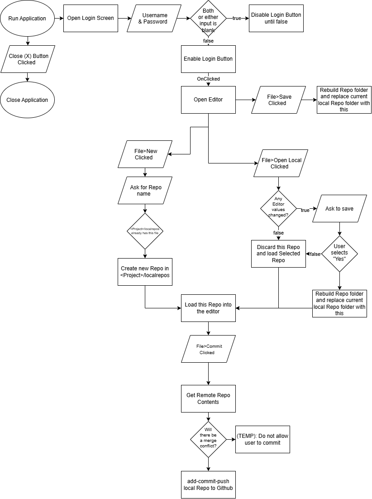

# grad-GithubRepoEditorJFX
# Github Repo Editor

An intuitive and user-friendly application that streamlines the Github Repository building process.

## The Problem

I find it tedious and confusing to manage Github repositories via Bash. I want to make a more user-friendly way to manage Github repositories.

## How It Works

A paragraph or a few bullets explaining what the software does at a
high level. If you have a diagram, embed it here:

- Allows the user to create, edit, and manage local repositories to push to remote ones on Github.
- Git MUST be installed on your device
- Default repository structure is generated automatically

## Tech Stack

- **Language:** Java
- **Libraries:** JavaFX, JGit
- **External tools:** Maven, EclipseIDE

## Setup

(Refer to Usage)

## Usage

1. Make sure you have Git installed on your device
2. Locate to src/main/java/githubrepoeditor
3. Open and run MainApp.java in the Java IDE of your choice.

## Roadmap

Features you haven't built yet but plan to (pull these from your
"Schedule" quadrant in the Eisenhower Matrix).

- [] SSH key login option
- [] Repo Cloning
- [] Get Repos directly from user’s Github account
- [] Properly handle merge conflicts
- [] Proper visuals
- [] Pull Requests

## Author

Samuel Kranz [https://github.com/Gradualdsd](Gradualdsd)

